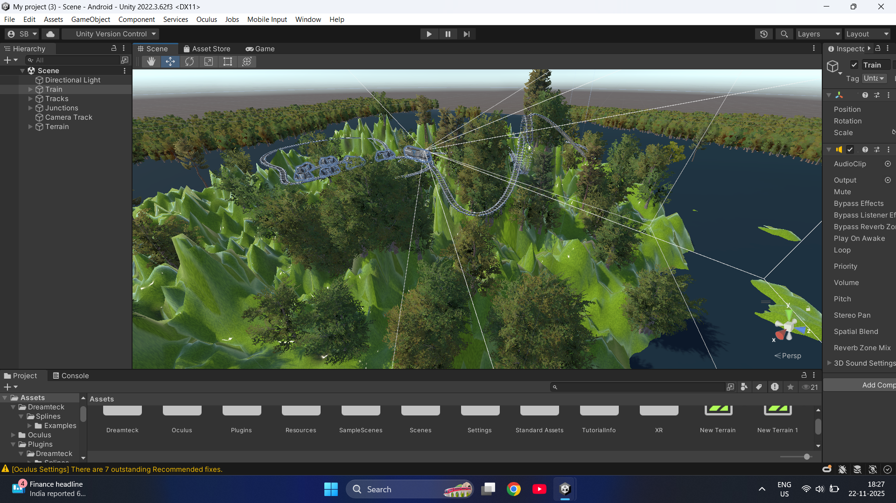

# VR Roller Coaster Ride

An immersive VR experience simulating a roller coaster ride, exploring virtual environment design, motion simulation, and spatial presence.

### Key Features
- Simulated roller coaster movement
- Immersive virtual environment
- Motion-based VR experience

### Skills & Technologies
Unity · Virtual Reality · Environment Design · Motion Simulation